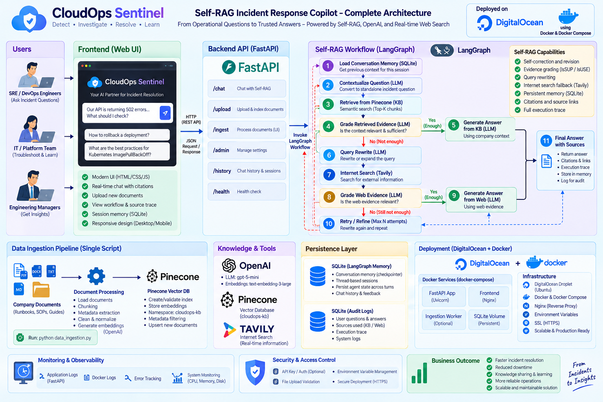

# 🛡️ OpsPilot — Agentic AI Incident Response Copilot

**OpsPilot** is an agentic Self-RAG system for cloud operations and incident response. It retrieves private operational runbooks, evaluates whether the retrieved evidence is relevant, rewrites weak queries, falls back to web search when internal knowledge is insufficient, and verifies generated answers before returning troubleshooting guidance.

Built with **LangGraph, OpenAI, Pinecone, Tavily, FastAPI, SQLite, and Docker**.

---

## Why OpsPilot?

Traditional RAG systems often follow a simple pipeline:

```text
Question → Retrieve Documents → LLM → Answer
```

That approach can fail when retrieval is poor, the knowledge base does not contain the answer, or the LLM generates claims that are not supported by the retrieved evidence.

OpsPilot adds an agentic decision and evaluation layer around RAG:

```text
Question
   ↓
Understand Incident Context
   ↓
Decide Whether Retrieval Is Needed
   ↓
Search Private Runbooks
   ↓
Grade Retrieved Evidence
   ↓
 ┌───────────────────┐
 │ Evidence Relevant?│
 └─────────┬─────────┘
           │
      Yes  │  No
           │
           ↓
     Generate Answer      Rewrite Query
           │                   ↓
           │            Retry Private KB
           │                   ↓
           │            Web Search Fallback
           │                   ↓
           └──────────────→ Generate
                                ↓
                        Grounding / Support Check
                                ↓
                       Revise if Unsupported
                                ↓
                         Usefulness Check
                                ↓
                           Final Answer
                                ↓
                       Persist Incident Memory
```

Instead of assuming the first retrieval and generation are correct, the system can **retrieve, evaluate, rewrite, retry, verify, and recover**.

---

## Architecture



The application is implemented as a conditional **LangGraph state machine**.

Core workflow nodes include:

```text
contextualize
      ↓
decide_retrieval
      ↓
retrieve
      ↓
grade
   ↙       ↘
generate   rewrite_internal
   ↓              ↓
support         retrieve
   ↓
revise (if needed)
   ↓
usefulness
   ↓
commit_memory
```

When private evidence remains insufficient:

```text
rewrite_web
     ↓
Tavily Search
     ↓
grade
     ↓
generate
     ↓
support
     ↓
usefulness
```

---

## Key Features

### 🔎 Private Runbook Retrieval

Operational knowledge is embedded using:

```text
OpenAI text-embedding-3-large
```

and stored in a configurable **Pinecone** namespace.

The application retrieves the top matching chunks before generating incident-response guidance.

---

### 🧠 Agentic Retrieval Decisions

Not every question requires RAG.

OpsPilot first determines whether a question should use:

- private operational knowledge,
- general model knowledge,
- or eventually external search.

This prevents unnecessary retrieval for simple conversational or general questions.

---

### 📊 Retrieval Relevance Grading

Retrieved documents are not automatically trusted.

An LLM-based grader evaluates each retrieved chunk against the incident question.

```text
Pinecone Results
       ↓
Relevance Grader
       ↓
Relevant Evidence?
```

Only relevant evidence moves forward into answer generation.

---

### 🔁 Query Rewriting & Retrieval Recovery

If private retrieval is weak, OpsPilot rewrites the query and searches again.

```text
Weak Retrieval
      ↓
Rewrite Query
      ↓
Search Pinecone Again
```

Retry behavior is bounded through configurable limits:

```env
MAX_RETRIEVAL_REWRITES=2
MAX_WEB_REWRITES=2
MAX_SUPPORT_RETRIES=2
```

This prevents uncontrolled agent loops.

---

### 🌐 Controlled Web Search Fallback

If private runbooks cannot provide sufficient evidence, the workflow can transition to **Tavily web search**.

```text
Private KB
   ↓
Insufficient Evidence
   ↓
Rewrite for Web
   ↓
Tavily Search
   ↓
Grade Web Results
   ↓
Generate Answer
```

External information is treated differently from organization-specific runbooks so web guidance is not presented as internal procedure.

---

### 🛡️ Grounding / Hallucination Checks

Generated answers pass through a support verification stage.

The evaluator classifies an answer as:

```text
fully_supported
partially_supported
no_support
```

If important claims are unsupported, the workflow sends the answer through a revision node.

```text
Generated Answer
      ↓
Support Check
      ↓
Unsupported?
      ↓
Revise Answer
      ↓
Support Check Again
```

The goal is to reduce unsupported troubleshooting recommendations.

---

### ✅ Answer Usefulness Evaluation

Grounding alone does not guarantee that an answer actually solves the user's problem.

OpsPilot therefore performs a separate usefulness evaluation:

```text
Question + Answer
       ↓
Usefulness Grader
       ↓
useful / not_useful
```

An unhelpful answer can trigger another retrieval attempt or web-search path.

---

### 💬 Persistent Incident Memory

Follow-up questions reuse the same incident context through a stable `thread_id`.

LangGraph state is persisted using:

```text
SQLite + LangGraph SqliteSaver
```

Example:

```text
User:
"Our checkout API started returning 502 errors after deployment.
What should I check first?"

OpsPilot:
[retrieves relevant checkout runbook]

User:
"What should I check next if that doesn't work?"
```

The second question is contextualized using the previous incident conversation before retrieval continues.

LangGraph checkpoints are stored locally in:

```text
data/langgraph_memory.sqlite
```

---

### 📝 Audit Logging

OpsPilot maintains a separate SQLite audit trail for completed requests.

Each audit can contain:

- original question
- generated answer
- selected route
- whether web search was used
- support status
- usefulness status
- execution trace
- returned sources
- timestamp

This makes agent behavior easier to inspect and debug.

---

### 📚 Dynamic Knowledge-Base Uploads

New operational documents can be uploaded directly through the UI.

Supported formats:

```text
PDF
TXT
Markdown
DOCX
```

The upload pipeline performs:

```text
Document
   ↓
Loader
   ↓
Recursive Text Splitting
   ↓
OpenAI Embeddings
   ↓
Pinecone
```

Chunks use deterministic IDs based on document content and position, helping repeated ingestion avoid generating arbitrary duplicate IDs.

---

## Tech Stack

| Layer | Technology |
|---|---|
| Agent orchestration | LangGraph |
| LLM | OpenAI |
| Embeddings | OpenAI `text-embedding-3-large` |
| Vector database | Pinecone |
| External search | Tavily |
| Backend/API | FastAPI |
| Persistence | SQLite |
| Document processing | LangChain |
| Frontend | HTML / CSS / JavaScript |
| Containerization | Docker |
| Language | Python |

---

## Project Structure

```text
.
├── app.py
├── data_ingestion.py
├── Dockerfile
├── requirements.txt
├── .env.example
│
├── src/
│   ├── config.py
│   ├── db.py
│   ├── ingestion.py
│   ├── models.py
│   ├── self_rag.py
│   └── vectorstore.py
│
├── documents/
│   ├── checkout-api-runbook.md
│   ├── deployment-rollback-sop.md
│   └── payments-high-cpu-runbook.md
│
├── templates/
│   └── index.html
│
├── static/
│   ├── app.js
│   └── styles.css
│
├── docs/
│   └── architecture_diagram.png
│
├── uploads/
└── tests/
```

---

# Getting Started

## 1. Clone the Repository

```bash
git clone <your-repository-url>
cd OpsPilot--Agentic-AI-Incident-Response-Copilot
```

---

## 2. Create a Virtual Environment

macOS/Linux:

```bash
python -m venv .venv
source .venv/bin/activate
```

Windows:

```bash
python -m venv .venv
.venv\Scripts\activate
```

---

## 3. Install Dependencies

```bash
pip install -r requirements.txt
```

---

## 4. Configure Environment Variables

Copy:

```text
.env.example
```

to:

```text
.env
```

Required API keys:

```env
OPENAI_API_KEY=
PINECONE_API_KEY=
TAVILY_API_KEY=
```

Default configuration:

```env
OPENAI_MODEL=gpt-5-mini
EMBEDDING_MODEL=text-embedding-3-large
EMBEDDING_DIMENSION=3072

PINECONE_INDEX_NAME=cloudops-sentinel-openai-self-rag
PINECONE_NAMESPACE=incident-runbooks
PINECONE_CLOUD=aws
PINECONE_REGION=us-east-1

TOP_K=5
MAX_SUPPORT_RETRIES=2
MAX_RETRIEVAL_REWRITES=2
MAX_WEB_REWRITES=2

DATABASE_PATH=data/audit.db
```

> Never commit your `.env` file or API keys to Git.

---

## 5. Build the Private Knowledge Base

Place operational documents inside:

```text
documents/
```

Then run:

```bash
python data_ingestion.py
```

The ingestion pipeline:

```text
Load Documents
      ↓
Split into 800-character chunks
      ↓
160-character overlap
      ↓
Generate OpenAI Embeddings
      ↓
Create / Validate Pinecone Index
      ↓
Upsert Stable Chunk IDs
      ↓
Knowledge Base Ready
```

The application and ingestion pipeline share the same vector-store configuration to prevent mismatches between ingestion and retrieval.

---

## 6. Run OpsPilot

```bash
python app.py
```

or:

```bash
uvicorn app:app --reload
```

Open:

```text
http://127.0.0.1:8000
```

---

# API

### Health Check

```http
GET /api/health
```

Example response:

```json
{
  "status": "ok",
  "service": "cloudops-sentinel-self-rag"
}
```

---

### Chat

```http
POST /api/chat
```

Request:

```json
{
  "question": "Our checkout API is returning 502 errors after deployment. What should I check first?",
  "thread_id": "incident-001"
}
```

The response includes information such as:

```text
answer
route
used_web_search
support_status
usefulness
sources
trace
thread_id
memory_turns
```

---

### Upload Operational Knowledge

```http
POST /api/upload
```

Accepts:

```text
.pdf
.txt
.md
.docx
```

Uploaded documents are chunked, embedded, and added to the existing Pinecone namespace.

---

### Audit History

```http
GET /api/audits
```

Returns recent agent execution records stored in SQLite.

The result limit is bounded between `1` and `100`.

---

# Example Incident Scenarios

### Private Runbook Retrieval

```text
Our checkout API is returning 502 errors after deployment.
What should the on-call engineer check first?
```

Expected behavior:

```text
Private Runbooks
```

---

### Persistent Incident Context

Follow immediately with:

```text
What should I check next if that doesn't work?
```

The same `thread_id` allows LangGraph to contextualize the follow-up using previous incident state.

---

### Dynamic Knowledge Update

Upload a new runbook through the UI and ask a question whose answer exists only in that document.

The new document is added to the existing Pinecone namespace without restarting the knowledge-base architecture.

---

### Web Search Fallback

Ask about an operational issue that is not represented in the private runbooks.

Expected workflow:

```text
Private Retrieval
      ↓
Relevance Failure
      ↓
Internal Query Rewrite
      ↓
Private Retrieval Retry
      ↓
Insufficient Evidence
      ↓
Tavily Search
      ↓
Evidence Grading
      ↓
Grounded Answer
```

---

# Safety & Reliability Design

OpsPilot intentionally includes several controls that are easy to omit from simple RAG demonstrations:

**Evidence-first generation**  
Context-based answers are instructed to use supplied evidence rather than invent infrastructure details.

**Private knowledge preferred**  
Internal operational documentation is searched before external sources.

**External-source separation**  
Web results are treated as external guidance rather than company-specific procedure.

**Retrieval grading**  
Vector similarity alone does not determine whether evidence is usable.

**Grounding verification**  
Generated claims are evaluated against retrieved evidence.

**Answer revision**  
Unsupported responses can be rewritten before being returned.

**Bounded retries**  
Retrieval, web search, and grounding loops have configurable limits.

**Safe failure**  
If reliable evidence cannot be found, the workflow can stop rather than fabricate a troubleshooting action.

---

# What This Project Demonstrates

OpsPilot was built to explore the engineering challenges that appear when moving beyond a basic RAG chatbot:

- Agentic workflow orchestration
- Conditional graph routing
- Self-RAG
- Semantic vector retrieval
- Retrieval evaluation
- Query transformation
- Tool use
- Web-search fallback
- Grounded generation
- Hallucination mitigation
- LLM-as-a-judge evaluation
- Persistent conversational state
- Auditability
- Document ingestion
- REST API development
- Containerized deployment

The focus is not simply generating an answer—it is building an AI workflow that can **decide how to find evidence, evaluate that evidence, recover from weak retrieval, verify its output, and expose its reasoning path for inspection.**

---

## Future Improvements

Potential extensions include:

- hybrid dense + keyword retrieval
- reranking models
- PostgreSQL-backed production checkpointing
- authentication and role-based access control
- observability and latency/token-cost dashboards
- automated RAG evaluation datasets
- human approval for high-risk remediation actions
- cloud deployment and autoscaling
- integration with monitoring and incident-management platforms

---

## License

This project is licensed under the terms included in the repository's `LICENSE` file.

---

## Author

**Aryan Jain**  
Computer Science & Data Science — University of Wisconsin–Madison

Interested in **AI Engineering, Agentic AI, RAG, LLM systems, MLOps, and production AI infrastructure**.
